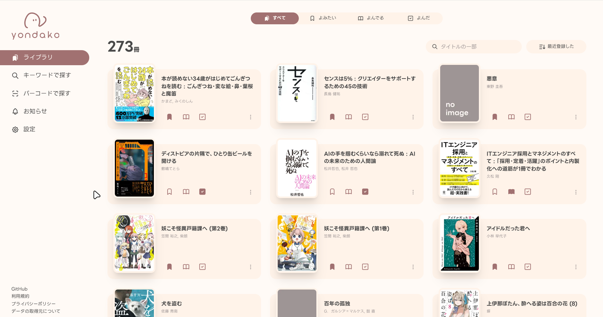

import scanDemoVideoUrl from "./assets/scan.mp4?url"

## ライブラリタブに「すべて」を追加しました

yondako で追加したすべての書籍をみることができるタブです。  
「あの本って読んだんだっけ」と思って よんだ タブで検索したけど見つからなかった、といったことがあったんですが、これで解決です ✌️

## バーコード検索のスキャン精度が上がりました

一部スマートフォンにおいて、なかなかピントが合わずスキャンできない問題を改善しました。  
スマホを機種変したら全く読めなくて困っていたので、とても嬉しいです。

<video src={scanDemoVideoUrl} autoplay loop muted playsinline></video>

バーコードの連続スキャンにも対応予定です。(わたしも欲しいなと思っています)  
もう少々お待ちいただければと思います 🙏

## ライブラリのスワイプ移動が自然になりました

なんか微妙にガタガタしていたのですが、今回の更新で軽快に見えるようになりました。  
気持ちがいいです。

## その他

- サーバー側で行う処理のパフォーマンス調整を行いました
- ページ間を移動際のもたつきを改善しました

---

久々の更新でしたが、じわじわと改善を進めています。

すっからかんな検索ページに何を置けばいいのか悩んでいる yondako をこれからもよろしくお願いします 🐾
